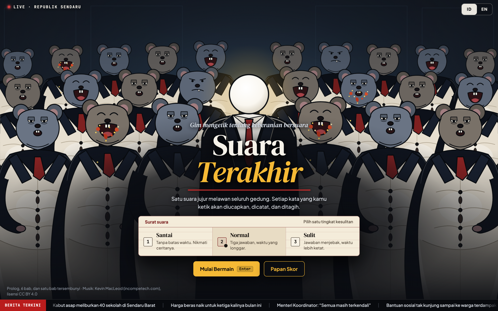
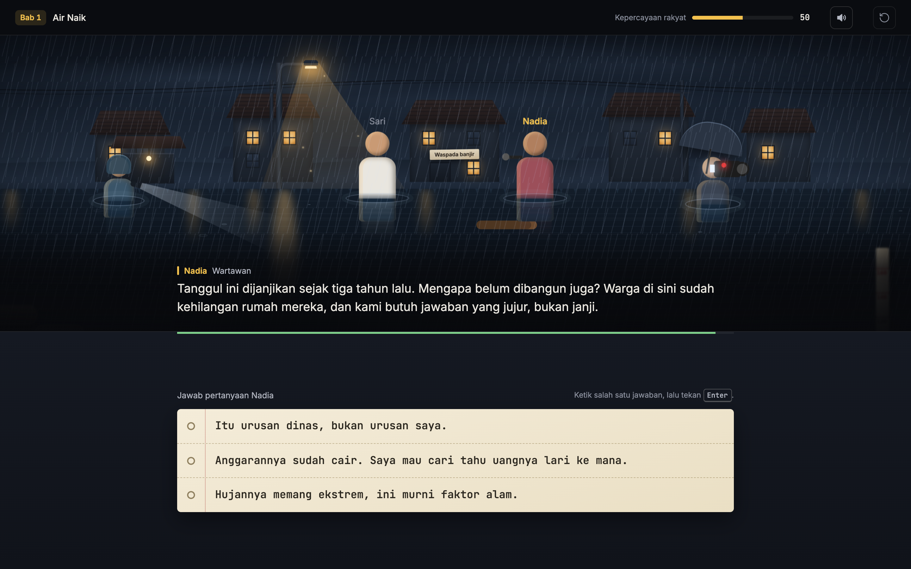

# Suara Terakhir

Gim mengetik tentang keberanian bersuara. Kamu jadi anggota dewan baru di Republik Sendaru, dan setiap kata yang kamu ketik akan diucapkan, dicatat, dan ditagih.

**[Main sekarang di browser](https://ojancode.github.io/suara-terakhir/)**

## Cara main

- Pilih tingkat kesulitan: Santai (tanpa batas waktu), Normal, atau Sulit (jawaban menjebak, waktu lebih ketat).
- Isi kartu anggota dewan dengan namamu.
- Setiap kali ada pertanyaan, ketik salah satu jawaban yang tersedia, lalu tekan Enter.
- Jawabanmu mengubah kepercayaan rakyat, dan janji yang kamu ucapkan akan ditagih di bab berikutnya.

Ceritanya terdiri dari prolog, 6 bab, dan satu bab tersembunyi, dengan 7 ending berbeda. Yang menamatkan semua bab masuk papan skor.

Tersedia dalam bahasa Indonesia dan Inggris (tombol ID | EN di layar judul).

## Kredit

Musik: Kevin MacLeod ([incompetech.com](https://incompetech.com)), lisensi CC BY 4.0.
